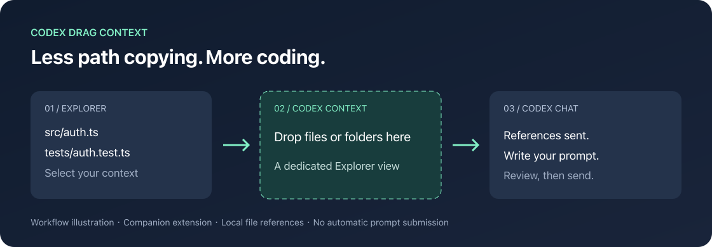

<div align="center">

# Codex Drag Context

**Less path copying. More coding.**

Send files from the VS Code Explorer to Codex through a dedicated drop zone.

[中文](README.md) · [Download VSIX](https://github.com/zzb040506/codex-drag-context/releases/latest) · [Report an issue](https://github.com/zzb040506/codex-drag-context/issues)



</div>

## Your files are already selected. Keep going.

You found the implementation, the failing test, and the config. Handing them to your coding assistant should take one gesture, without another round of copying paths and switching focus.

Codex Drag Context adds a **Codex Context** view to Explorer:

- Drop one or more local file or folder references onto its target row.
- Use the Explorer context menu for the same action, including multi-selection.
- Click `+` to choose paths without dragging.
- Get batch deduplication, ordered dispatch, and partial failure counts.

**The drop zone is a separate Explorer view, not the existing Codex composer.** The extension sends path references. It does not submit prompts or recursively upload directories.

## Install and use

1. Install and sign in to the official OpenAI **Codex** extension (`openai.chatgpt`).
2. Download `codex-drag-context-0.1.0.vsix` from [Releases](https://github.com/zzb040506/codex-drag-context/releases/latest).
3. In VS Code, open Extensions → `…` → **Install from VSIX…**. Reload if prompted.
4. Open a local project and your intended Codex conversation.
5. Expand **Explorer → Codex Context**, then drop files onto **Drop files or folders here**.
6. Check that references appear in Codex, write your prompt, and send it yourself.

Alternatively, right-click selected resources → **Codex: Add File or Folder to Codex Chat**, or run **Codex: Choose Files or Folders for Codex** from the command palette.

```sh
code --install-extension ./codex-drag-context-0.1.0.vsix
```

Existing downloads are distributed through GitHub Releases; Marketplace availability has not been confirmed. The 0.1.0 VSIX uses publisher `local`. The 0.1.1 Marketplace candidate uses the created publisher `Fantasia040506`; Marketplace publication remains pending verification. See the [Marketplace publishing guide](docs/marketplace-publishing.md).

**Migration:** disable or uninstall `local.codex-drag-context` before installing the new candidate, because the changed publisher creates a separate extension ID and can cause duplicate views and commands.

## Compatibility and limitations

This is an early, independent community companion extension, unaffiliated with OpenAI.

- Accepts local `file:` URIs only. SSH, WSL, and Dev Container resource URIs are unsupported.
- Folder paths are forwarded as references. Codex determines how to display or inspect them; recursive behavior has not been verified.
- Uses `chatgpt.addFileToThread`, found by inspecting the installed Codex extension. This is **not a confirmed stable public API** and may change.
- `Sent N references` means the command returned successfully, not that the Codex UI acknowledged attachments.
- Command registration and URI handling were inspected locally with VS Code `1.144.0` and Codex `26.1021.22027` on macOS. Actual GUI drag/drop and attachment behavior have not yet been verified; other platforms are unverified too.
- Manifest minimum is VS Code 1.96; it is not a claim of testing every supported version.

The extension has no runtime third-party dependencies. Its own code does not read file contents, make network requests, collect telemetry, or send prompts. Codex's subsequent handling follows your Codex product and account settings.

## Troubleshooting

**Missing view:** enable the extension, then use **View: Open View...** and search for **Codex Context**.

**Missing command:** open the official Codex extension, update it, and reload VS Code. If it persists, report both extension versions and the exact error; the integration command may have changed.

**No attachment after a successful dispatch:** check the active conversation and retry the context menu with one local text file. Report the result as a compatibility issue.

## Develop

Use Node.js 22+ and npm:

```sh
git clone https://github.com/zzb040506/codex-drag-context.git
cd codex-drag-context
npm ci
npm run check
npm run package
```

Open the project in VS Code and press `F5` for an Extension Development Host. Tests cover URI parsing, deduplication, remote URI filtering, batch ordering, partial failures, and activation failures. They do not replace a manual Codex UI check.

See [CONTRIBUTING.md](CONTRIBUTING.md) for the manual checklist and release process. Platform reports and compatibility fixes are especially welcome. If this saves you a few interruptions, give it a Star or share it with another Codex user.

[MIT License](LICENSE)
