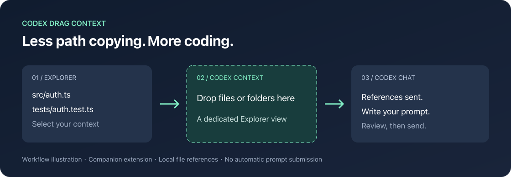

<div align="center">

# Codex Drag Context

**文件就在眼前，为什么还要复制路径？**

把资源管理器中的文件拖进 **Codex Context**，把注意力留给真正要解决的问题。

[English](README.en.md) · [下载安装包](https://github.com/zzb040506/codex-drag-context/releases/latest) · [报告问题](https://github.com/zzb040506/codex-drag-context/issues)


[](https://github.com/zzb040506/codex-drag-context/actions/workflows/ci.yml)



</div>

## 从「找到文件」到「开始提问」，少几步

你已经在资源管理器里选中了报错文件、相关测试和配置文件。接下来，本该直接告诉 Codex 要做什么，却又要复制路径、切换窗口、粘贴，再确认有没有漏掉一个。

Codex Drag Context 在 VS Code 资源管理器里增加一个小小的 **Codex Context** 区域。选中文件，拖进去，再到 Codex 输入需求。

- **拖一下就交接**：从资源管理器拖入一个或多个本地文件、文件夹引用。
- **右键也能发**：多选后右键 → `Codex: Add File or Folder to Codex Chat`。
- **不方便拖？点 +**：通过选择器添加本地文件或文件夹。
- **反馈更清楚**：同一批去重，连续操作排队，失败时提示已发送数量。
- **小而透明**：运行时代码无第三方依赖；扩展本身不读取文件正文、不发网络请求、不收集遥测。

> **先说清楚入口**：拖放目标是资源管理器中的独立 **Codex Context** 面板，不是 Codex 原有的聊天输入框。它将路径引用交给 Codex，既不自动发送提问，也不承诺递归上传整个文件夹。文件夹引用如何展示和使用，取决于 Codex 版本。

## 1 分钟安装

1. 在 VS Code 中安装并登录 OpenAI 官方 **Codex** 扩展（扩展 ID：`openai.chatgpt`）。
2. 从 [Releases](https://github.com/zzb040506/codex-drag-context/releases/latest) 下载 `codex-drag-context-0.1.0.vsix`。
3. 打开 VS Code 扩展面板，点击右上角 `…` → **Install from VSIX… / 从 VSIX 安装…**，选择下载的文件。
4. 如果 VS Code 提示重新加载窗口，按提示操作。在左侧资源管理器中展开 **Codex Context**。

也可以用终端安装：

```sh
code --install-extension ./codex-drag-context-0.1.0.vsix
```

本项目目前通过 GitHub Release 分发，尚未上架 Marketplace。`local` 是当前 VSIX 的 publisher 标识，不代表 Marketplace 发布者认证。

## 怎么用

### 拖放

1. 打开项目，再打开你希望添加上下文的 Codex 对话。
2. 在 VS Code 资源管理器里选中文件或文件夹，支持多选。
3. 拖到 **Codex Context → Drop files or folders here** 这一行。
4. 切回 Codex，确认引用出现，输入你的需求后自行发送。

例如，选中 `src/auth.ts` 和 `tests/auth.test.ts` 后，可以问：

> 请检查登录失败的原因，结合这个测试定位问题，并给出最小修改。

### 右键 / 选择器

- **右键**：选中文件或文件夹 → 右键 → `Codex: Add File or Folder to Codex Chat`。
- **选择器**：点击 **Codex Context** 标题右侧的 `+`。
- **命令面板**：运行 `Codex: Choose Files or Folders for Codex`。

`Sent N references to Codex` 表示调用 Codex 命令成功返回；最终是否出现附件，请以 Codex 对话界面为准。

## 支持范围与已知限制

| 项目 | 当前状态 |
| --- | --- |
| 本地文件、多选、批次内去重 | 已实现；核心派发逻辑有自动化测试 |
| 文件夹 | 传递文件夹路径引用；下游展示和递归行为未验证 |
| Explorer 拖放 | 已实现 `text/uri-list` 接收；实际 GUI 拖放仍需人工验证 |
| 直接拖到 Codex 输入框 | 本扩展未提供此功能 |
| SSH / WSL / Dev Containers | 不支持远程 URI；只接受 `file:` |
| 平台 | 本地在 macOS 打包；其他平台及 GUI 行为尚未验证 |
| VS Code | 最低版本声明为 1.96；并未逐版本测试 |

这是一个早期的社区伴侣扩展，与 OpenAI 无隶属关系。当前集成使用 Codex 扩展命令 `chatgpt.addFileToThread`。该命令来自本机扩展实现检查，**不是本项目确认过的稳定公共 API**，后续版本可能变更。

本地检查环境：VS Code `1.144.0`、`openai.chatgpt@26.1021.22027`。该记录表示检查过命令注册和 URI 处理代码，不代表完成端到端 GUI 验证。欢迎提交带环境信息的实测反馈。

## 常见问题

**看不到 Codex Context？**

确认扩展已启用，然后在命令面板运行 `View: Open View...` 搜索 `Codex Context`。也可以在资源管理器标题区域的视图菜单中重新勾选它。

**提示命令不存在？**

确认官方 Codex 扩展已安装并可正常打开。先更新该扩展并重载窗口；仍报错时，请提供 VS Code 与 Codex 版本、错误文本和操作方式。这个错误也可能意味着集成命令已变更。

**提示成功，但对话里没看到引用？**

先检查当前 Codex 对话，再用单个本地文本文件尝试右键入口。成功反馈只表示命令返回，不包含 Codex 的 UI 确认。请把这类情况作为兼容性问题反馈。

**拖的是整个文件夹，会把所有文件读进来吗？**

本扩展只交接文件夹路径，不遍历目录。是否展开、读取哪些文件由 Codex 决定。

**会把代码上传到别处吗？**

本扩展本身只在本机把 URI 交给官方 Codex 扩展，不独立读取正文或连接服务。交接之后 Codex 如何处理上下文，遵循你使用的 Codex 产品和账号设置。

## 本地开发

需要 Node.js 22+ 与 npm。运行时不需要额外服务。

```sh
git clone https://github.com/zzb040506/codex-drag-context.git
cd codex-drag-context
npm ci
npm run check
npm run package
```

用 VS Code 打开项目，按 `F5` 启动 Extension Development Host。在新窗口中打开本地项目与 Codex，按上面的步骤进行人工验证。

测试覆盖 URI 列表、去重、远程引用过滤、批次顺序、部分失败和依赖激活失败；它们不替代实际 Codex UI 测试。参见 [贡献指南](CONTRIBUTING.md) 和 [更新记录](CHANGELOG.md)。

## 下一步，一起把交接做顺手

优先欢迎三类贡献：不同平台的实际使用反馈、Codex 版本兼容性记录，以及更清晰的失败提示。提交问题时请使用仓库模板，避免包含 API Key、私有源码或敏感文件路径。

如果你也受够了在文件树和聊天框之间来回复制路径，可以给项目一个 Star，或把它分享给用 Codex 的同事。

[MIT License](LICENSE) · Made for developers who already know which files matter.
